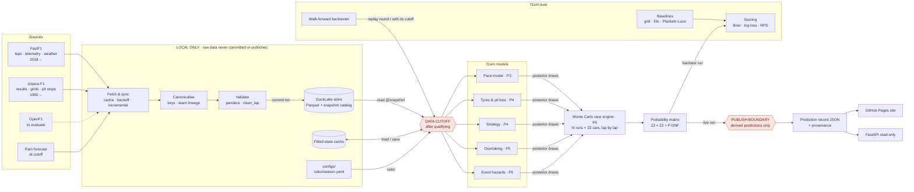
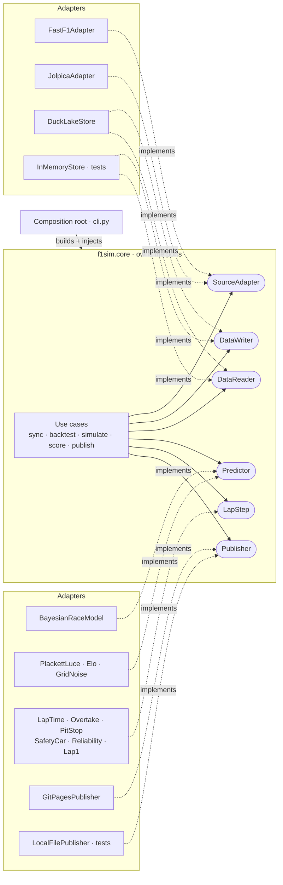
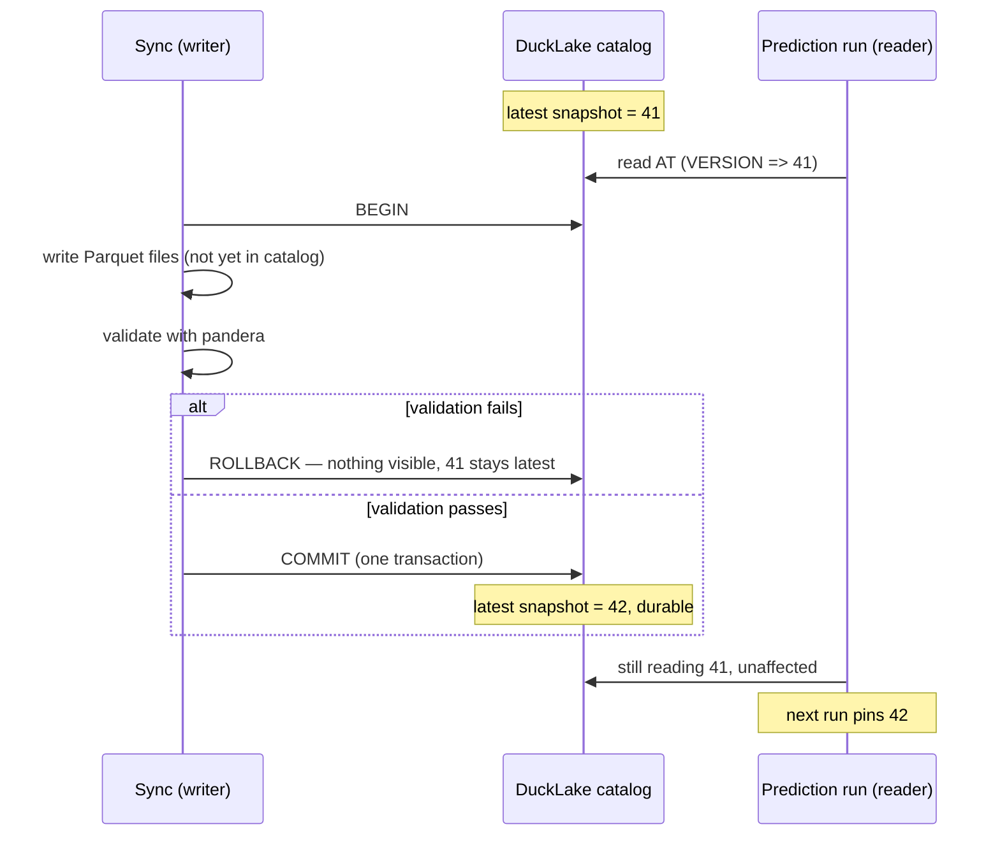
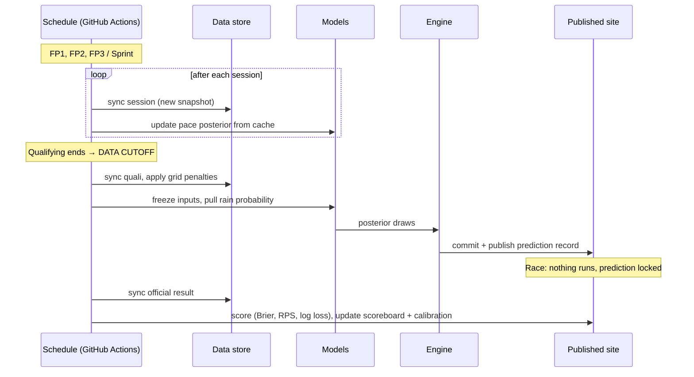
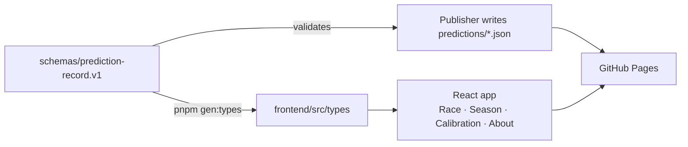
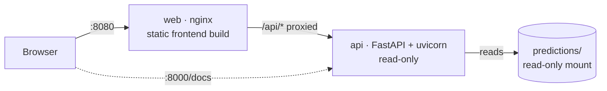

# Shpeed Architecture

Draft 3 · 11 Oct 2026 · companion to `docs/architecture/Shpeed Architecture.html` (the full diagrams) and `ROADMAP.md` (what gets built when).

Shpeed (`f1sim`) is an open-source F1 race simulator. It fetches public timing data, fits Bayesian models of pace, tyres, strategy and race events, simulates each race lap by lap thousands of times, and publishes a probability for every driver finishing in every position.

The diagrams below are Mermaid, so they render on GitHub and in most Markdown editors.

---

## 1. System overview



**Two hard boundaries:**

- **Data cutoff.** Models only read data from before qualifying ends. A live prediction and a backtest replay run the same code; the backtester just moves the cutoff back in time, and a leakage guard (`CutoffReader`) fails on any read past it. The exact cutoff and grid rules are in ADR-0005.
- **Publish boundary.** Raw timing data stays on the machine (ADR-0001). Only derived predictions are published.

### Repository layout

```
Shpeed/
  src/f1sim/
    core/              # no I/O libraries (enforced by import-linter)
      domain/          # SessionKey, EventKey, RaceState, PositionMatrix
      ports/           # SourceAdapter, DataWriter, DataReader, Predictor, LapStep, Publisher
      engine/          # Monte Carlo loop over LapSteps
      scoring/         # Brier, RPS, calibration
      usecases/        # sync, backtest, simulate, score, publish
      errors.py
    resources/         # data shipped in the wheel: team_lineage.yaml
    adapters/
      sources/         # FastF1Adapter, JolpicaAdapter, shared HTTP layer
      store/           # DuckLakeStore, InMemoryStore (tests), pandera schemas, writer lock
      models/          # baselines and registry, pace, tyres, strategy, overtaking, hazards
      benchmarks.py    # benchmarks/<model>.json records and the regression gate
      steps/           # lap_time, overtake, pit_stop, safety_car, reliability, lap1
      publishers/      # git_pages, local_file (tests)
    api/               # read-only FastAPI service and its container health check
    reports/           # backtest reports
    settings.py        # the only module that reads environment variables
    observability.py   # structlog with run_id
    cli.py             # composition root
  frontend/            # React + TypeScript + Vite web app (section 6)
  schemas/             # prediction-record.v1.schema.json, shared by backend and frontend
  configs/             # rules/<season>.yaml, circuits, mapping notes
  typings/             # type stubs for untyped libraries (fastf1), used by pyright and Pylance
  tests/               # unit, property, contract, integration, perf, fixtures/recorded
  benchmarks/          # recorded backtest scores per model
  predictions/         # published prediction records
  docker/              # api.Dockerfile, web.Dockerfile, nginx.conf
  compose.yaml         # local stack; compose.dev.yaml adds hot reload
  notebooks/  scripts/  docs/{adr,architecture,planning,guides}/
  data/                # local DuckLake store, git-ignored (ADR-0001)
```

---

## 2. SOLID: ports and adapters

The core owns a few small interfaces (ports) and never imports FastF1, DuckDB, PyMC, NumPyro or FastAPI. Every heavy dependency lives in an adapter that implements a port, and `cli.py` wires them together from settings.



| Principle | The rule in Shpeed | How it's enforced |
|---|---|---|
| **S** · Single responsibility | Each module has one reason to change: adapters fetch, validators validate, the store commits, each LapStep models one race mechanic. | import-linter layer contracts in CI; PR checklist |
| **O** · Open/closed | New behaviour arrives as a new class or config file: a new LapStep, a registered Predictor, a new `rules/<season>.yaml`. The engine and backtester don't change. | Registries keyed by name; ablation toggles components by config |
| **L** · Liskov substitution | Any implementation of a port can replace another: every Predictor passes the same matrix invariants, every store the same read/write contract. | One contract-test suite per port, run against every implementation |
| **I** · Interface segregation | Ports are small. Reading and writing data are separate ports, so a prediction run gets a DataReader and cannot write. Predictor has only `fit` and `predict`. | Protocols kept to 1–3 methods; reviewed in ADRs |
| **D** · Dependency inversion | The core depends on ports it owns; adapters depend on the core. Only the composition root knows concrete classes. | import-linter forbids fastf1, duckdb, pymc, numpyro, fastapi imports inside `f1sim.core` |

---

## 3. ACID: where state lives

ACID applies to stored state, not to the simulation maths (pure functions plus a seed). Plain Parquet files are not transactional, so the data lake uses **DuckLake**, DuckDB's lakehouse format (v1.0, April 2026): a SQL catalog over immutable Parquet files, where every sync is one transaction and every read can be pinned to a snapshot (ADR-0002).



| State | Atomicity | Consistency | Isolation | Durability |
|---|---|---|---|---|
| Data lake (DuckLake) | One transaction per sync; all tables or none | pandera and schema checks before COMMIT; failure rolls back | Readers pin a snapshot; single-writer file lock | Committed catalog + immutable Parquet; `f1sim data verify` |
| Fitted-state cache | Temp file, then atomic rename | Keyed by model version, round and snapshot; schema version in header | Readers only see complete files; a key is never overwritten | fsync before rename |
| Prediction records | Record and index land in one git commit | Validated against JSON Schema v1 before writing | Workflow concurrency group, one run per round; immutable after lights out | Git history and GitHub Pages |
| Roadmap tracker | Not ACID: last write wins per feature. Fine for a single owner; `ROADMAP.md` in the repo is the versioned backup. | | | |

Every prediction record stores the snapshot ID it read, so any published forecast can be re-run against exactly the data it saw. Snapshot retention never expires a snapshot that a published prediction or benchmark cites.

---

## 4. Monte Carlo engine

Each lap, for N parallel runs (NumPy arrays of shape N × 22):

1. Sample lap times from posterior draws (pace + degradation + driver noise)
2. Roll events (safety car, VSC, red flag, DNFs)
3. Resolve overtakes (pace gap, circuit difficulty, dirty air, era-specific overtake aid)
4. Execute pit stops from each driver's sampled strategy
5. Update order and gaps → next lap

Seeded and reproducible; target 10,000 runs of one race in under a minute on a laptop, with Numba only if missed. Property tests check a valid ordering every lap, non-negative gaps, and every car finishing or classified DNF.

---

## 5. A race weekend at runtime



On a sprint weekend there is one practice session, so the pace prior stays wider and sprint laps carry more weight.

---

## 6. Frontend

A static React + TypeScript app (Vite, pnpm) in `frontend/`, deployed to GitHub Pages next to the committed prediction JSON (ADR-0004). It follows Apple's Human Interface Guidelines; the rules are in `frontend/DESIGN.md`.



- **One schema, two consumers.** The backend validates every record against the JSON Schema; the frontend generates its TypeScript types from the same file, so they cannot drift.
- **Design system.** `src/design/tokens.css` holds the Dynamic Type scale, semantic light/dark colours modelled on iOS system colours, a 4-pt spacing grid, translucent materials and motion that respects reduced-motion. Components use only tokens.
- **Navigation.** Tab bar on phones, sidebar on iPad and Mac widths; large titles; inset grouped lists; segmented controls for Win / Podium / Points.
- **Licensing.** SF Pro and SF Symbols are licensed for Apple platforms only, so the app uses the system font stack (SF Pro on Apple devices) and the open-source Lucide icons. No F1 or team marks.
- **Quality.** ESLint, Prettier, strict TypeScript, Vitest + Testing Library, Playwright smoke tests on desktop Safari and iPhone viewports.

---

## 7. Running it: Docker Compose



| File | Purpose |
|---|---|
| `compose.yaml` | Production-like local stack: `api` on :8000, `web` on :8080; `web` waits until `api` is healthy |
| `compose.dev.yaml` | Override for development: uvicorn `--reload` with `src/` mounted, Vite dev server on :8080 (same port as production, so no override tags) with `frontend/` mounted; polling on for Windows/macOS bind mounts |
| `docker/api.Dockerfile` | Multi-stage: `build` (uv, frozen lockfile, `api` extra only) → `runtime` (slim, non-root uid 10001, health check) and `dev` |
| `docker/web.Dockerfile` | Multi-stage: `deps` (pnpm, frozen lockfile) → `build` (Vite, `VITE_API_URL=/api`) → `runtime` (unprivileged nginx on :8080) and `dev` |
| `docker/nginx.conf` | SPA fallback, `/api` proxy, one-year caching for hashed assets, no-cache for `index.html`, security headers (CSP, nosniff, frame deny) |

Both runtime containers run read-only with a tmpfs `/tmp`, and the API mounts `predictions/` read-only, matching its read-only design. The same frontend build works in two modes: with `VITE_API_URL` set it reads from the API (Docker); without it, from static files (GitHub Pages). CI builds both images, starts the stack and smoke-tests it.

The data pipeline (`f1sim data sync`, `predict`) is not a service: it runs as a CLI job, on a schedule in GitHub Actions or locally with `uv run`.

---

## 8. Where the race variables land

| Component | Variables it absorbs | Phase |
|---|---|---|
| Pace model | team pace and development drift, car–circuit fit, engine supplier, 2026 energy deployment, driver vs teammate, quali vs race pace, consistency, fuel load, track evolution | P3 |
| Tyres & pit loss | compound, degradation, the cliff, warm-up, track temperature, abrasiveness, pit-lane loss, team stop times | P4 |
| Strategy | stop count and timing, starting tyre, sets left, mandatory compound rule, team habits | P4 |
| Overtaking & dynamics | overtaking difficulty, racecraft, dirty air, DRS (to 2025) vs Overtake Mode and active aero (2026), straight-line speed, traffic, defending | P5 |
| Starting state | grid after penalties, pit-lane starts, grid side | P5 |
| Event hazards | safety car, VSC, red flag, mechanical and accident DNFs, lap 1, in-race penalties, rain regime | P6 |
| Left out | setup, fuel and battery state (latent), fatigue, home race, contract news | — |

---

## 9. Decisions

| # | Decision | Why |
|---|---|---|
| D1 · ADR-0001 | Raw data stays on the machine | Fetched by code and cached locally; only derived predictions are published, which handles licensing risk |
| D2 | One predict path, two callers | Backtester and live run share the pipeline, so backtest scores describe the live system |
| D3 | Rules live in config | `configs/rules/<season>.yaml`; the 2026 reset is a data change, not a code change |
| D4 | Models hand over draws | The engine samples posteriors, so model uncertainty flows into the matrix |
| D5 | Fitted state is cached | Weekend updates start from the last posterior; NumPyro or VI if PyMC is too slow (ADR-0003) |
| D6 | Components earn their place | Merge only if it beats Plackett–Luce on RPS; keep only if the ablation says so |
| D7 · ADR-0002 | Transactional store on DuckLake | Atomic syncs and snapshot-pinned reads; any forecast can be replayed |
| D8 | Core owns the interfaces | Heavy libraries live behind small ports; swapping one touches one adapter |
| D9 · ADR-0004 | React + TypeScript + Vite frontend on Apple HIG | Static app on Pages; types generated from the shared schema |

---

## 10. Prediction record (proposed schema v1)

```jsonc
// predictions/2027/01.json
{
  "schema_version": 1,
  "season": 2027,
  "round": 1,
  "data_cutoff": "2027-03-13T16:02:11Z",
  "snapshot_id": 42,
  "model_version": "0.9.0",
  "git_commit": "a1b2c3d",
  "n_sims": 10000,
  "seed": 20270313,
  "p_rain": 0.15,
  "drivers": [
    { "driver_id": "...", "p_position": [0.31, 0.22, 0.14], "p_dnf": 0.06 }  // p_position has 22 values summing to 1
  ],
  "score": null  // filled by the scoring run
}
```

---

## 11. Engineering practices

| Area | Practice |
|---|---|
| Testing | Unit; property tests (hypothesis) on matrix and race-state invariants; one contract suite per port; integration on recorded fixtures with the network blocked; backtest regression and performance benchmark for model/engine PRs |
| CI gates | Ruff, strict pyright, import-linter, 85% coverage on core, pip-audit, RPS regression gate; all required on protected main |
| Workflow | Trunk-based; branches like `feat/P1-02-fastf1-adapter`; Conventional Commit PR titles with the feature ID; squash merges; PR template with the definition of done |
| Decisions | ADRs for anything hard to undo (ADR-0001 raw data, ADR-0002 DuckLake, ADR-0003 inference backend) |
| Reproducibility | uv lockfile, seeded RNG, snapshot ID + model version + git commit on every output |
| Releases | SemVer, keep-a-changelog, tags build the release, Docker image and PyPI package (trusted publishing) |
| Observability | structlog JSON with run_id, per-stage timings, alert when a race-weekend run fails twice |
| Security | No secrets in repo, scoped workflow tokens, Dependabot, pip-audit, non-root Docker image, read-only API |
| Tracking | Feature IDs from `ROADMAP.md` run through branch, PR, commit and changelog |

---

## 12. Stack

Python 3.12 · uv · FastF1 · Jolpica-F1 · DuckLake (DuckDB + Parquet) · pandera · statsmodels · PyMC / NumPyro · NumPy (Numba if needed) · pytest + hypothesis · ruff · pyright · import-linter · FastAPI · Docker · GitHub Actions · GitHub Pages · mkdocs-material · PyPI · React · TypeScript · Vite · pnpm · Vitest · Playwright · Docker Compose · nginx

## 13. Open questions

- **Where does the API run in production?** Locally it runs in Docker Compose. Publicly, the Pages site can serve the committed JSON on its own, so hosting the API is optional (a small container host if wanted).
- **PyMC or NumPyro?** Decide at the end of Phase 3 by timing a full weekend update (ADR-0003).
- **OpenF1 as a second source?** Add if FastF1 reliability becomes a problem; otherwise it waits for the in-race stretch goal.
- **Historical odds?** Optional market benchmark if a clean source turns up.

---

*Unofficial project, not affiliated with Formula 1.*
