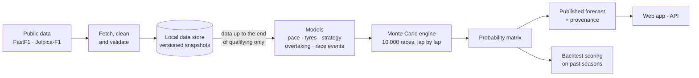

# Shpeed

**An open-source Formula 1 race simulator that forecasts every race as a set of honest probabilities, and publishes its track record so anyone can check how good those probabilities are.**

Before each Grand Prix, Shpeed simulates the race lap by lap, thousands of times. Each run samples car pace, tyre wear, pit strategy, overtakes, safety cars and retirements. From the outcomes it computes the probability of every driver finishing in every position. After the race, it scores that forecast against the official result in public.

> **Project status: Phase 1 of 10 (data ingestion).** The foundations, read-only API, web app shell, Docker setup and the data pipeline are built and tested offline. The first sync against the live data sources, the baselines and the models come next, so there are no real forecasts yet. See [What works today](#what-works-today) and [ROADMAP.md](ROADMAP.md).
>
> Shpeed is an unofficial project. It is not associated with Formula 1, the FIA or any team.

---

## Contents

- [What Shpeed does](#what-shpeed-does)
- [Why it exists](#why-it-exists)
- [How it works](#how-it-works)
- [What works today](#what-works-today)
- [Getting started](#getting-started)
- [Using the API](#using-the-api)
- [The web app](#the-web-app)
- [Project structure](#project-structure)
- [Engineering principles](#engineering-principles)
- [Data sources and licensing](#data-sources-and-licensing)
- [Roadmap](#roadmap)
- [Contributing](#contributing)
- [FAQ](#faq)
- [Licence and acknowledgements](#licence-and-acknowledgements)

---

## What Shpeed does

For each race, after qualifying, Shpeed answers questions like these:

| Question | Example answer (illustrative) |
|---|---|
| Who is likely to win? | Driver A 31%, Driver B 24%, Driver C 19% … |
| What are the chances of a podium, or of scoring points? | Driver D: podium 49%, points 92% |
| How likely is a driver to retire? | Driver F: 10% chance of not finishing |
| How much does the forecast depend on rain? | Rain probability at forecast time: 15% |

Every forecast is a **probability matrix**: one row per driver, one column per finishing position, plus a "did not finish" probability. Win, podium and points chances are all read off that matrix.

Each published forecast also records **exactly how it was made**: the code version, model version, data snapshot, random seed and the moment its data was frozen. Anyone can re-run it and get the same numbers. Once the race starts, a forecast is never changed.

## Why it exists

Most F1 predictions are opinions, or models that are never scored. Shpeed aims to be:

- **Probabilistic.** It gives a chance for every outcome, not just a predicted winner, because races are uncertain and the uncertainty is the useful part.
- **Accountable.** It scores every forecast after the race with proper scoring rules (Brier score, log loss, ranked probability score) and publishes a calibration chart. When it says 30%, that should happen about 30% of the time.
- **Reproducible.** It uses public data only, open code, and records exactly which data and code produced each forecast.
- **A research tool.** Its headline question comes from the 2026 regulation reset: *when history stops being a reliable guide, how quickly can a model become accurate again, and which approach gets there fastest?* The project studies the 2022 and 2026 resets to find out.

## How it works



1. **Collect.** Lap times, tyre stints, weather, track status and race-control messages come from [FastF1](https://docs.fastf1.dev/) (2018 onwards). Results, grids and pit stops back to 1950 come from [Jolpica-F1](https://github.com/jolpica/jolpica-f1), the successor to the Ergast API.
2. **Store safely.** Data is validated, then committed to a local DuckLake store (Parquet files with a transactional catalog). Every sync is all-or-nothing and creates a numbered snapshot, so a forecast can always point to the exact data it used.
3. **Model.** Bayesian models estimate:
   - each car's and driver's race pace, updated after every practice session;
   - how each tyre compound wears at each circuit;
   - which pit strategies teams are likely to choose;
   - how hard it is to overtake;
   - how often safety cars, retirements and first-lap incidents happen.
4. **Simulate.** The engine runs the race 10,000 times. Each lap it samples lap times, rolls for events, resolves overtakes and executes pit stops. All runs are vectorised in NumPy and seeded, so results are reproducible.
5. **Publish and score.** After qualifying, the forecast is published as JSON with its provenance. After the race, it is scored against the official result, and the season scoreboard and calibration chart update.
6. **Prove it on history first.** A walk-forward backtester replays the 2022–2025 seasons race by race. It uses the same code as the live forecast and cannot see data from after each race's cutoff. A model is only merged if it beats simple baselines; the strongest baseline is a Plackett–Luce ranking model.

The full design (components, boundaries, data flow and decisions) is in [ARCHITECTURE.md](ARCHITECTURE.md), with hand-drawn diagrams in `docs/architecture/Shpeed Architecture.html`.

## What works today

| Area | Status |
|---|---|
| Repository structure, CI, linting, strict typing, import-layer checks | ✅ In place |
| Core domain types, interfaces (ports), probability matrix, scoring metrics | ✅ Built, with unit and property tests |
| Read-only API (`/health`, `/predictions`, `/predictions/latest`, `/predictions/{season}/{round}`) | ✅ Built, tested |
| Web app shell: Race, Season, Calibration and About screens, Apple-style design system | ✅ Built; the Race screen shows clearly labelled sample data in development |
| Docker Compose stack (API + web), with a hot-reload development mode | ✅ In place |
| Data ingestion: `f1sim data sync`, `verify`, `report`, `gc` | ✅ Built and tested offline; first live sync pending |
| Baselines and backtester | 🔜 Phase 2 |
| Pace, tyre, strategy and event models; Monte Carlo engine | 🔜 Phases 3–6 |
| Automated race-weekend forecasts | 🔜 Phase 8 |
| Public v1.0 with live forecasts | 🔜 Phase 9, targeted for the 2027 season opener |

The `predict`, `backtest` and `report score` commands exist but raise `NotImplementedError` with the roadmap ID of the feature that will implement them.

## Getting started

### Option 1: Docker (recommended)

You need [Docker Desktop](https://www.docker.com/products/docker-desktop/), or Docker Engine with Compose v2.24 or later.

```bash
git clone <your-fork-url> shpeed && cd shpeed
docker compose up --build
```

| Open | What you get |
|---|---|
| http://localhost:8080 | The web app (nginx serving the built frontend; `/api` is proxied to the API) |
| http://localhost:8000/docs | Interactive API documentation |

For development, with code changes applied live on both sides:

```bash
docker compose -f compose.yaml -f compose.dev.yaml up --build
```

The web app stays on http://localhost:8080 (now the Vite dev server with hot reload), and the API restarts when files in `src/` change. Stop with `Ctrl+C`; remove the containers with `docker compose down`.

### Option 2: Run locally

You need Python 3.12 with [uv](https://docs.astral.sh/uv/getting-started/installation/), and Node 20+ with [pnpm](https://pnpm.io/installation).

**Backend**

```bash
uv sync --all-extras                                  # environment from the lockfile
uv run pytest                                         # tests
uv run uvicorn f1sim.api.app:app --reload             # API on http://localhost:8000
uv run f1sim --help                                   # command-line interface
```

**Load real data** (needs internet access; the first season takes a while because FastF1 downloads every session, later runs only fetch what is new):

```bash
uv run f1sim data sync --season 2024                  # Jolpica results + FastF1 laps, weather, track status
uv run f1sim data verify                              # every stored file present
uv run f1sim data report --season 2024                # per-session data-quality table
```

**Frontend** (in a second terminal)

```bash
cd frontend
pnpm install
pnpm dev                                              # http://localhost:5173 with sample data
VITE_API_URL=/api pnpm dev                            # or: read from the local API on :8000
```

On Windows PowerShell, set the variable first: `$env:VITE_API_URL="/api"; pnpm dev`.

**Quality checks** (the same ones CI runs)

```bash
uv run ruff check . && uv run ruff format --check . && uv run pyright && uv run lint-imports && uv run pytest
cd frontend && pnpm lint && pnpm typecheck && pnpm test && pnpm build
```

### Configuration

Settings are read from environment variables prefixed `F1SIM_`, or from a `.env` file (copy `.env.example`).

| Variable | Default | Purpose |
|---|---|---|
| `F1SIM_DATA_DIR` | `data` | Local data store location |
| `F1SIM_PREDICTIONS_DIR` | `predictions` | Where published forecasts are read from and written to |
| `F1SIM_LOG_LEVEL` | `INFO` | Log level (JSON logs, each run tagged with a `run_id`) |
| `F1SIM_SEED` | `20261012` | Default random seed |
| `F1SIM_N_SIMS` | `10000` | Simulations per race |
| `F1SIM_CORS_ORIGINS` | `[]` | Browser origins allowed to call the API directly, as a JSON list |

## Using the API

The API is **read-only**. It serves the published forecasts in `predictions/` and never writes anything.

| Endpoint | Returns |
|---|---|
| `GET /health` | Service status and version |
| `GET /predictions` | Every published race, oldest first: `[{"season": 2027, "round": 1}, …]` |
| `GET /predictions/latest` | The most recent forecast, or `404` if none is published yet |
| `GET /predictions/{season}/{round}` | One race's forecast, or `404` |

A forecast looks like this (abridged; the full contract is [`schemas/prediction-record.v1.schema.json`](schemas/prediction-record.v1.schema.json)):

```json
{
  "schema_version": 1,
  "season": 2027,
  "round": 1,
  "data_cutoff": "2027-03-13T16:02:11Z",
  "snapshot_id": 42,
  "model_version": "0.9.0",
  "git_commit": "a1b2c3d",
  "n_sims": 10000,
  "seed": 20270313,
  "p_rain": 0.15,
  "drivers": [
    { "driver_id": "...", "p_position": [0.31, 0.22, 0.14, "..."], "p_dnf": 0.06 }
  ],
  "score": null
}
```

`p_position[k]` is the probability of finishing in position k+1. Together with `p_dnf`, each driver's probabilities sum to 1. `score` is filled in by the post-race scoring run.

## The web app

The frontend in [`frontend/`](frontend/) is a React + TypeScript app built with Vite. It follows Apple's Human Interface Guidelines: a clear type hierarchy, semantic light and dark colours, translucent navigation bars, inset grouped lists and a segmented control for Win / Podium / Points. Phones get a tab bar; iPad and Mac widths get a sidebar. The design rules are in [`frontend/DESIGN.md`](frontend/DESIGN.md).

| Screen | Shows |
|---|---|
| Race | The latest forecast, with win, podium and points probabilities per driver |
| Season | Every scored race and how the model did |
| Calibration | Predicted versus observed frequencies, as a chart and a table |
| About | How the forecasts are made |

The same build works in two modes. With `VITE_API_URL` set (as in Docker), it reads from the API. Without it (as on GitHub Pages), it reads the static `predictions/` files.

## Project structure

```
shpeed/
├── src/f1sim/                  Python package
│   ├── core/                   domain logic with no I/O libraries (enforced in CI)
│   │   ├── domain/             race state, probability matrix, identifiers
│   │   ├── ports/              interfaces: SourceAdapter, DataReader/Writer, Predictor, LapStep, Publisher
│   │   ├── engine/             Monte Carlo race loop
│   │   ├── scoring/            Brier, ranked probability score, calibration
│   │   └── usecases/           sync, backtest, simulate, score, publish
│   ├── adapters/               FastF1, Jolpica, DuckLake store, models, race-mechanic steps, publishers
│   ├── api/                    read-only FastAPI service
│   ├── settings.py             typed settings (the only place env vars are read)
│   └── cli.py                  command line; wires adapters into the core
├── frontend/                   React + TypeScript web app and design system
├── schemas/                    JSON Schema shared by backend and frontend
├── configs/                    season rules, circuits, ID mappings
├── tests/                      unit · property · contract · integration · performance
├── predictions/                published forecasts, one JSON file per race
├── benchmarks/                 recorded backtest scores per model
├── docker/  compose.yaml       container images and the local stack
├── docs/                       decision records, architecture, planning, guides
├── notebooks/                  research write-ups
└── data/                       local data store (git-ignored, rebuilt by sync)
```

## Engineering principles

Shpeed is built to be maintained for years by more than one person. The details are in [ARCHITECTURE.md](ARCHITECTURE.md) and [CONTRIBUTING.md](CONTRIBUTING.md); in short:

- **SOLID, through ports and adapters.** The core owns small interfaces and never imports heavy libraries. FastF1, DuckDB, PyMC and FastAPI live in adapters behind those interfaces. Swapping one library touches one adapter, and import-linter fails CI if the rule is broken.
- **ACID where state is stored.** Each data sync is one transaction: all of it is committed, or none of it. Validation runs before commit. Forecasts read a pinned snapshot, so a sync in progress can never leak into a forecast. Published forecasts are written atomically and never edited after the race starts.
- **No look-ahead.** Models can only read data from before the cutoff. A test plants future data and fails loudly if any of it is read.
- **Earned complexity.** A model component is merged only if it improves the backtest, and kept only if switching it off makes the backtest worse.
- **Quality gates on every change:**
  - linting (Ruff, ESLint, Prettier) and strict type-checking (Pyright, TypeScript);
  - 85% test coverage on core code;
  - property-based tests for race-state and probability invariants;
  - offline tests that replay recorded data;
  - a dependency vulnerability audit;
  - a Docker build and smoke test.
- **Decisions are written down.** Anything hard to reverse gets an architecture decision record in [`docs/adr/`](docs/adr/).

## Data sources and licensing

- **FastF1** provides lap timing, telemetry and session data from 2018. **Jolpica-F1** provides historical results.
- **Raw data is never committed or redistributed** ([ADR-0001](docs/adr/0001-raw-data-never-committed.md)). It is fetched by code into `data/`, which git ignores. The project publishes only derived forecasts and scores.
- **No F1 or team marks.** The web app uses no Formula 1 or team logos or trademarks. Teams are shown by name with neutral colours.

## Roadmap

Ten phases over about 26 weeks take the project from an empty repository to v1.0:

| Phase | Focus |
|---|---|
| 0 | Foundations: repo, tooling, CI, scaffold |
| 1 | Data ingestion and the transactional store |
| 2 | Baselines and the evaluation harness |
| 3 | Pace model |
| 4 | Tyres and strategy |
| 5 | Monte Carlo race simulator (**v0.1 MVP**) |
| 6 | Race events: safety cars, retirements, lap 1, weather |
| 7 | Regulation-reset study |
| 8 | Automated delivery and the web app |
| 9 | Open-source launch (**v1.0**) |

Each phase ends with a gate it must pass before the next begins. All 130 features, with their acceptance criteria, dependencies and status, are in [ROADMAP.md](ROADMAP.md).

## Contributing

Contributions are welcome once the project reaches its public launch, and feedback is welcome now.

1. Pick a feature from [ROADMAP.md](ROADMAP.md) whose dependencies are done.
2. Branch as `feat/<ID>-short-name` (for example `feat/P1-02-fastf1-adapter`).
3. Open a pull request titled with [Conventional Commits](https://www.conventionalcommits.org/) and the feature ID.
4. Meet the definition of done: tests, green CI, the feature's acceptance criterion demonstrated, docs or ADR updated, and a changelog entry.

[CONTRIBUTING.md](CONTRIBUTING.md) has the full workflow. To add a model, a race mechanic or a data source, see [docs/guides/adding-a-component.md](docs/guides/adding-a-component.md).

## FAQ

**Is this a betting tool?**
No. Shpeed is a research and forecasting project. Its probabilities are estimates with real uncertainty, published to be scored, not advice.

**Why not just predict the winner?**
A single pick hides how confident the model is. A probability for every outcome can be checked: across many races, events forecast at 30% should happen about 30% of the time.

**Why does the forecast freeze after qualifying?**
So every forecast is made on the same footing, and so the backtest on past seasons measures exactly what the live system does.

**How accurate is it?**
Not known yet; finding out is part of the project. Backtest results for 2022–2025, and the live track record from 2027, will be published with every model release.

**Can I run it without Docker?**
Yes. See [Option 2: Run locally](#option-2-run-locally).

## Licence and acknowledgements

Shpeed is released under the [MIT Licence](LICENSE).

It builds on the work of the [FastF1](https://github.com/theOehrly/Fast-F1) and [Jolpica-F1](https://github.com/jolpica/jolpica-f1) projects, without which public F1 data analysis would not be possible.
